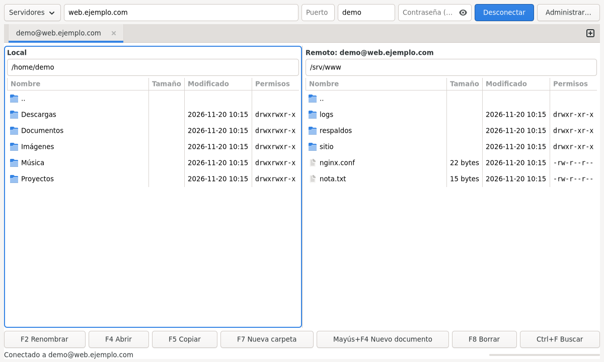
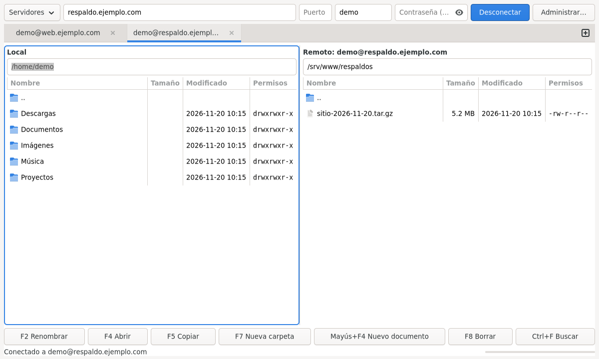
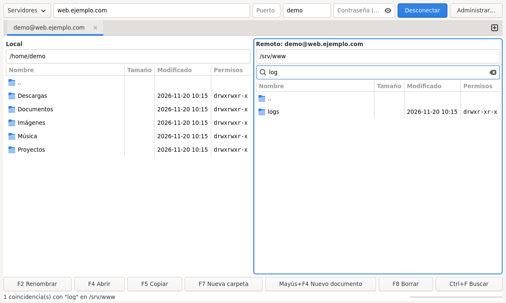
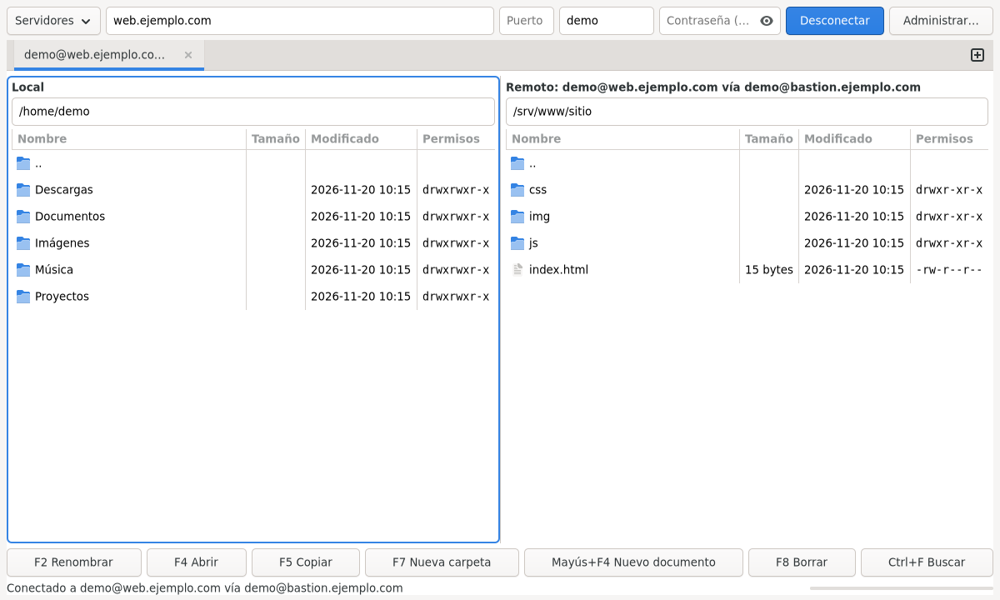
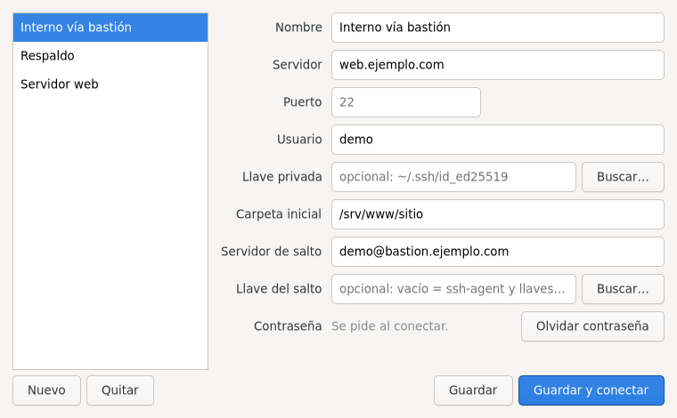
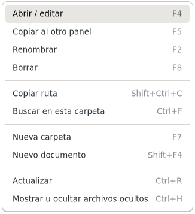

<p align="center">
  
</p>

<h1 align="center">SFTP Commander</h1>

<p align="center">
  <b>Cliente SFTP nativo y rápido, de dos paneles, para Linux y Windows.</b><br>
  El modo Commander de WinSCP, hecho desde cero en C con GTK 4 y libssh.
</p>

<p align="center">
  <a href="https://github.com/reybendg/sftp-comander/releases/latest"></a>
  
  
  <a href="LICENSE"></a>
</p>

<p align="center">
  <a href="README.md">English</a> · <b>Español</b>
  &nbsp;|&nbsp;
  <a href="#descarga">Descarga</a> ·
  <a href="#funciones">Funciones</a> ·
  <a href="#instalación">Instalación</a> ·
  <a href="docs/guia-de-uso.md">Guía de uso</a> ·
  <a href="CHANGELOG.md">Cambios</a>
</p>

<p align="center">
  
</p>

## Acerca de

SFTP Commander muestra tu equipo a la izquierda y el servidor a la derecha. Los archivos se pasan de un lado a otro con el teclado (**F5** copia, **F8** borra, **F7** crea una carpeta) o con el menú del clic derecho, como en WinSCP o Total Commander.

- **Nativo y liviano.** Una app GTK 4 que abre al instante y usa poca memoria: sin Java, Electron ni Wine.
- **Usa lo que ya tienes.** Los alias de `~/.ssh/config`, `known_hosts`, tus llaves y el ssh-agent funcionan sin configurar nada.
- **Cuida tus contraseñas.** Solo se guardan si lo pides, en el llavero del sistema (GNOME Keyring en Linux, Administrador de credenciales en Windows), nunca en archivos de texto.
- **Listo para infraestructura real.** Servidores de salto, bastiones como [Warpgate](https://warpgate.null.page/), códigos de un solo uso y aprobación en el navegador.

Es un programa nuevo, no un port de WinSCP: toma la idea, no el código.

## Descarga

| Sistema | Archivo | Notas |
|---|---|---|
| **Windows 10 / 11** (64 bits) | [`sftp-commander-0.7.0-instalador.exe`](https://github.com/reybendg/sftp-comander/releases/download/v0.7.0/sftp-commander-0.7.0-instalador.exe) | Instalador, no pide administrador |
| | [`sftp-commander-0.7.0-windows-x64.zip`](https://github.com/reybendg/sftp-comander/releases/download/v0.7.0/sftp-commander-0.7.0-windows-x64.zip) | Portable: descomprimir y abrir |
| **Debian 13** (trixie) | [`sftp-commander_0.7.0-1~deb13_amd64.deb`](https://github.com/reybendg/sftp-comander/releases/download/v0.7.0/sftp-commander_0.7.0-1.deb13_amd64.deb) | `sudo apt install ./<archivo>` |
| **Ubuntu 24.04** / Mint 22 | [`sftp-commander_0.7.0-1~ubuntu24.04_amd64.deb`](https://github.com/reybendg/sftp-comander/releases/download/v0.7.0/sftp-commander_0.7.0-1.ubuntu24.04_amd64.deb) | `sudo apt install ./<archivo>` |
| Otro Linux | [Compilar desde el código](#compilar-desde-el-código) | Toma un minuto |

Todos los archivos están en la página de [Releases](https://github.com/reybendg/sftp-comander/releases).

## Funciones

<table>
  <tr>
    <td width="50%"></td>
    <td width="50%"></td>
  </tr>
  <tr>
    <td><b>Pestañas.</b> Una sesión por pestaña, cada una con su conexión, sus paneles y su progreso. Conéctate a varios servidores a la vez.</td>
    <td><b>Buscar mientras escribes</b> en la carpeta actual (Ctrl+F), sin distinguir mayúsculas, con comodines <code>*</code> y <code>?</code>.</td>
  </tr>
  <tr>
    <td></td>
    <td></td>
  </tr>
  <tr>
    <td><b>Servidores de salto</b> como <code>ssh -J</code>, con llave o contraseña, y <b>bastiones</b> como Warpgate con códigos de un solo uso y aprobación en el navegador.</td>
    <td><b>Servidores guardados</b> con servidor, puerto, usuario, llave, carpeta inicial y servidor de salto. Las contraseñas van al llavero, nunca al archivo.</td>
  </tr>
</table>

**Y además:**

- **Edita archivos remotos.** Doble clic sobre un archivo del servidor: se abre en tu editor local y cada vez que guardas se sube solo.
- **Conexión perdida.** Al volver a una pestaña cuya red se cortó, eliges *Reconectar* (a la misma carpeta), *Ahora no* o *Cerrar pestaña*.
- **Progreso de la conexión** con cada paso (conexión, llavero, inicio de sesión) y botón *Cancelar*.
- **Copiar, renombrar, borrar, nueva carpeta y nuevo documento vacío**, recursivo en carpetas, con barra de progreso y cancelar.
- **Copiar ruta** de lo seleccionado al portapapeles (Ctrl+Mayús+C).
- **Verificación segura del servidor** contra `known_hosts` con huellas SHA256. Si la llave cambió, no conecta.
- **No bloquea tu cuenta.** Nunca repite solo las respuestas a las preguntas del servidor, y nunca manda la contraseña a un servidor que no la acepta.
- **Enlaces `sftp://`** se abren con SFTP Commander (opcional en Windows).

<p align="center">
  
</p>

### Atajos de teclado

| Tecla | Acción | Tecla | Acción |
|---|---|---|---|
| **F5** | Copiar al otro panel | **Ctrl+F** | Buscar en la carpeta |
| **F2** | Renombrar | **Ctrl+Mayús+C** | Copiar ruta |
| **F4** / Enter | Abrir o editar | **Ctrl+T** / **Ctrl+W** | Nueva / cerrar pestaña |
| **F7** | Nueva carpeta | **Ctrl+R** | Actualizar |
| **Mayús+F4** | Nuevo documento vacío | **Ctrl+H** | Archivos ocultos |
| **F8** / Supr | Borrar (pregunta antes) | **Ctrl+L** | Servidores guardados |
| Retroceso | Subir un nivel | | |

## Instalación

### Windows

Ejecuta **`sftp-commander-<versión>-instalador.exe`**. Instala solo para tu usuario en `%LOCALAPPDATA%\Programs\SFTP Commander`, sin permisos de administrador, con acceso en el menú Inicio y, si quieres, acceso directo en el escritorio y los enlaces `sftp://`. Se desinstala desde *Configuración > Aplicaciones*; tus servidores guardados y contraseñas se conservan.

¿Prefieres no instalar nada? Descomprime el **`.zip`** donde quieras y abre `SFTP Commander.cmd`.

> El instalador todavía no está firmado, así que SmartScreen puede decir que el editor es desconocido: elige *Más información > Ejecutar de todas formas*.

En Windows el panel local tiene un botón *Unidad* para `C:\`, `D:\` y pendrives; las llaves y `known_hosts` se leen de `%USERPROFILE%\.ssh`, y los archivos remotos se abren con el programa asociado a su extensión (el Bloc de notas si no hay ninguno).

### Debian 13 / Ubuntu 24.04

```bash
sudo apt install ./sftp-commander_0.7.0-1~deb13_amd64.deb         # Debian 13
sudo apt install ./sftp-commander_0.7.0-1~ubuntu24.04_amd64.deb    # Ubuntu 24.04, Mint 22
```

apt trae las dependencias. Se quita con `sudo apt remove sftp-commander`.

> Si abres un `.deb` bajado con el Centro de aplicaciones de Ubuntu, avisa que es "potencialmente inseguro": lo hace con cualquier paquete que no venga de los repositorios de Ubuntu. Instalando con `apt` como arriba no aparece.

### Desde la terminal

```bash
sftp-commander                                       # ventana vacía
sftp-commander miservidor                            # un servidor guardado o un alias de ~/.ssh/config
sftp-commander usuario@host:2222                     # directo
sftp-commander usuario@interno -J usuario@bastion:22 # pasando por un servidor de salto
```

### Bastiones como Warpgate

Te conectas al bastión e indicas el destino en el usuario: servidor `warpgate.ejemplo.com`, puerto `2222`, usuario `tu_usuario:destino`. Si el bastión pide un código de un solo uso o la aprobación en el navegador, una ventana muestra la pregunta (con el enlace de aprobación clicable). Más detalles en la [guía de uso](docs/guia-de-uso.md#warpgate-y-bastiones-con-código-de-un-solo-uso-o-aprobación-en-el-navegador).

## Compilar desde el código

### Linux

| Biblioteca | Mínimo |
|---|---|
| GTK | 4.12 |
| libssh | 0.8 (se recomienda 0.10 o más nueva) |
| libsecret | 0.18 |
| GLib | 2.58 |

```bash
# Debian / Ubuntu / Mint
sudo apt install build-essential pkg-config libgtk-4-dev libssh-dev libsecret-1-dev
# Fedora
sudo dnf install gcc make pkgconf gtk4-devel libssh-devel libsecret-devel
# Arch
sudo pacman -S base-devel gtk4 libssh libsecret

git clone https://github.com/reybendg/sftp-comander.git
cd sftp-comander
make                  # arma ./sftp-commander
make install          # programa, ícono, menú y manejador de sftp:// en ~/.local
```

`make uninstall` lo quita. `make deb` arma y prueba los paquetes de Debian 13 y Ubuntu 24.04 en Docker (`MANTENEDOR="Nombre <correo>" make deb` indica el mantenedor).

### Windows

Se compila de forma nativa con [MSYS2](https://www.msys2.org/), en el entorno UCRT64:

```bash
pacman -S --needed make mingw-w64-ucrt-x86_64-gcc mingw-w64-ucrt-x86_64-pkgconf \
          mingw-w64-ucrt-x86_64-gtk4 mingw-w64-ucrt-x86_64-libssh mingw-w64-ucrt-x86_64-nsis
make                  # sftp-commander.exe, con su ícono y datos de versión
make windows          # carpeta portable, .zip e instalador en dist/
```

El ícono está en `data/sftp-commander.svg`; `make icono` regenera los PNG y el `.ico`.

### Probado en

| Sistema | Estado |
|---|---|
| Debian 13 (trixie) | Funciona, en uso diario |
| Ubuntu 24.04 LTS | Funciona (equipo real y contenedor) |
| Deepin 23.1 | Funciona, compilado desde el código (GTK 4.16) |
| Windows 11 (64 bits) | Funciona (MSYS2: GTK 4.24, libssh 0.12), también contra un bastión Warpgate real con código 2FA |
| Linux Mint 22, Fedora 40+, Arch | Debería funcionar, sin probar todavía |
| Debian 12, Ubuntu 22.04 | No compatible: GTK anterior a 4.12 |

### Pruebas

`tools/probar.sh` corre todas las pruebas sin tocar tu sistema: levanta un servidor SSH temporal como tu usuario en `127.0.0.1`, corre la prueba SFTP por línea de comandos y maneja la ventana real en Xvfb (conectar, pestañas, buscar, copiar ruta, conexión perdida, servidor de salto, contraseñas y edición remota). Necesita `openssh-server` (solo el binario) y `xvfb`.

`tools/probar-warpgate.sh` prueba contra un bastión Warpgate real en Docker, escuchando solo en 127.0.0.1: contraseña, código de un solo uso, código incorrecto (un solo intento fallido) y aprobación en el navegador.

`tools/capturas.sh` regenera las capturas de esta página con datos inventados en un contenedor Docker.

## Documentación

- [Guía de uso](docs/guia-de-uso.md): conectar, servidores guardados, contraseñas, pestañas, servidores de salto, bastiones, edición remota y solución de problemas.
- [User guide](docs/user-guide.md) (inglés).
- `man sftp-commander` después de instalar el `.deb`.

## Contribuir

Los reportes de errores, ideas y pull requests son bienvenidos en [Issues](https://github.com/reybendg/sftp-comander/issues).

## Licencia

Copyright (C) 2026 los autores de SFTP Commander.

SFTP Commander es software libre: puedes redistribuirlo y modificarlo según los términos de la [Licencia Pública General de GNU](LICENSE) publicada por la Free Software Foundation, versión 3 o (a tu elección) cualquier versión posterior. Se distribuye con la esperanza de que sea útil, pero SIN NINGUNA GARANTÍA.
