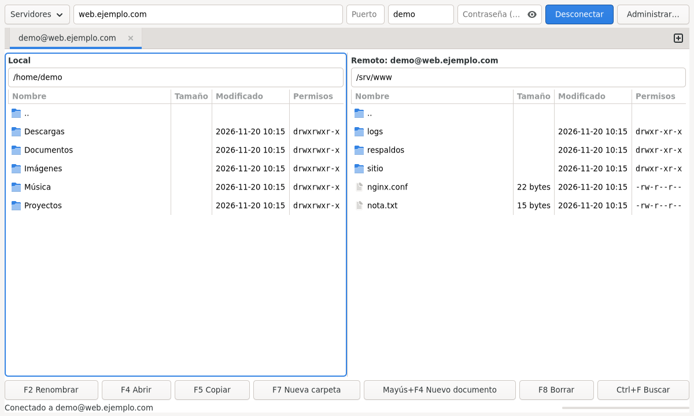
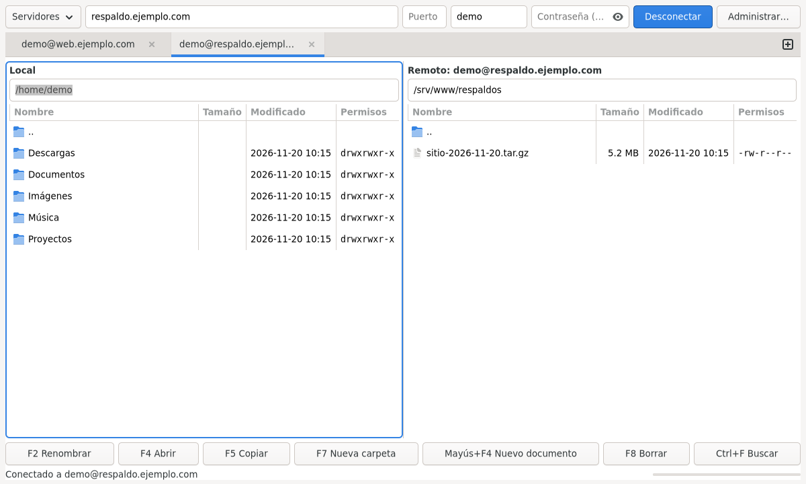
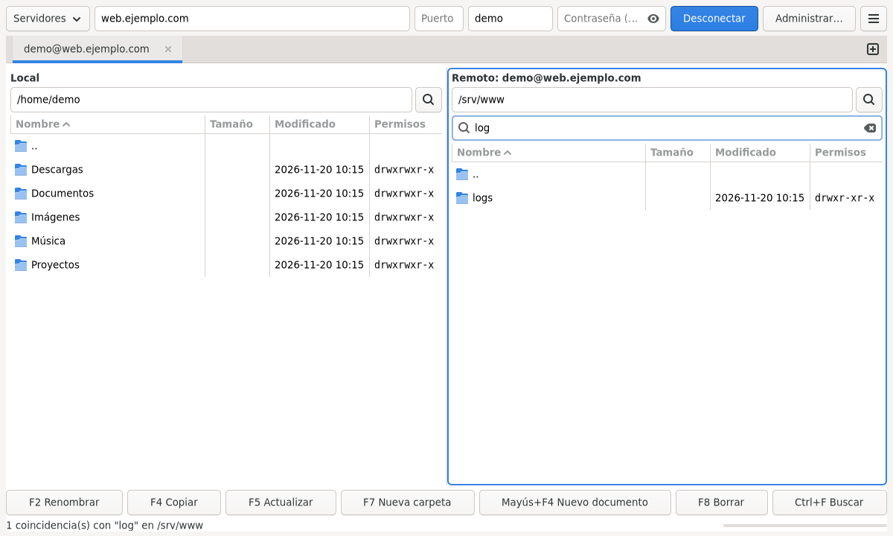
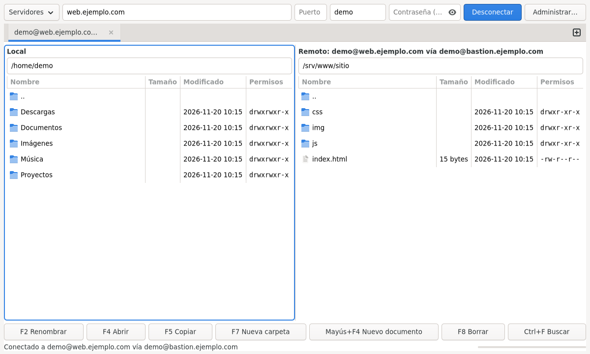
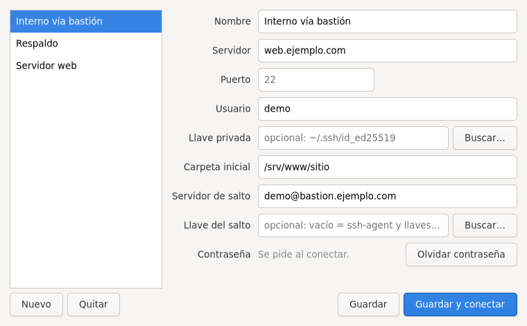
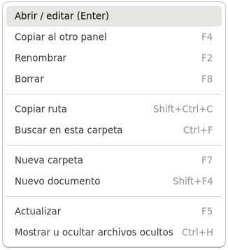

<p align="center">
  
</p>

<h1 align="center">SFTP Commander</h1>

<p align="center">
  <b>A fast, native two-pane SFTP client for Linux and Windows.</b><br>
  WinSCP's Commander mode, rebuilt from scratch in C with GTK 4 and libssh.
</p>

<p align="center">
  <a href="https://github.com/reybendg/sftp-comander/releases/latest"></a>
  
  
  <a href="LICENSE"></a>
</p>

<p align="center">
  <b>English</b> · <a href="README.es.md">Español</a>
  &nbsp;|&nbsp;
  <a href="#download">Download</a> ·
  <a href="#features">Features</a> ·
  <a href="#installation">Installation</a> ·
  <a href="docs/user-guide.md">User guide</a> ·
  <a href="CHANGELOG.md">Changelog</a>
</p>

<p align="center">
  
</p>

## About

SFTP Commander shows your computer on the left and the server on the right. You move files between them with the keyboard (**F5** copies, **F8** deletes, **F7** creates a folder) or with the right-click menu, just like WinSCP or Total Commander.

- **Native and light.** A GTK 4 app that starts instantly and uses little memory: no Java, Electron or Wine.
- **Uses what you already have.** `~/.ssh/config` aliases, `known_hosts`, your keys and ssh-agent work out of the box.
- **Safe with your passwords.** They are only stored if you ask, in the system keyring (GNOME Keyring on Linux, Credential Manager on Windows), never in plain files.
- **Ready for real infrastructure.** Jump servers, bastions such as [Warpgate](https://warpgate.null.page/), one-time codes and browser approval.

It is a new program, not a port of WinSCP: it borrows the idea, not the code.

> The interface is currently in **Spanish**. Translations are welcome.

## Download

| System | File | Notes |
|---|---|---|
| **Windows 10 / 11** (64-bit) | [`sftp-commander-0.7.0-instalador.exe`](https://github.com/reybendg/sftp-comander/releases/download/v0.7.0/sftp-commander-0.7.0-instalador.exe) | Installer, no administrator rights needed |
| | [`sftp-commander-0.7.0-windows-x64.zip`](https://github.com/reybendg/sftp-comander/releases/download/v0.7.0/sftp-commander-0.7.0-windows-x64.zip) | Portable, extract and run |
| **Debian 13** (trixie) | [`sftp-commander_0.7.0-1.deb13_amd64.deb`](https://github.com/reybendg/sftp-comander/releases/download/v0.7.0/sftp-commander_0.7.0-1.deb13_amd64.deb) | `sudo apt install ./<file>` |
| **Ubuntu 24.04** / Mint 22 | [`sftp-commander_0.7.0-1.ubuntu24.04_amd64.deb`](https://github.com/reybendg/sftp-comander/releases/download/v0.7.0/sftp-commander_0.7.0-1.ubuntu24.04_amd64.deb) | `sudo apt install ./<file>` |
| Other Linux | [Build from source](#build-from-source) | About a minute |

All files are on the [Releases](https://github.com/reybendg/sftp-comander/releases) page.

## Features

<table>
  <tr>
    <td width="50%"></td>
    <td width="50%"></td>
  </tr>
  <tr>
    <td><b>Tabs.</b> One session per tab, each with its own connection, panes and progress. Connect to several servers at once.</td>
    <td><b>Search as you type</b> in the current folder (Ctrl+F), case-insensitive, with <code>*</code> and <code>?</code> wildcards.</td>
  </tr>
  <tr>
    <td></td>
    <td></td>
  </tr>
  <tr>
    <td><b>Jump servers</b> like <code>ssh -J</code>, with key or password, and <b>bastions</b> like Warpgate with one-time codes and browser approval.</td>
    <td><b>Saved servers</b> with host, port, user, key, start folder and jump server. Passwords go to the keyring, never to the file.</td>
  </tr>
</table>

**And also:**

- **Edit remote files in place.** Double-click a remote file: it opens in your local editor, and every time you save it is uploaded back automatically.
- **Lost connection handling.** Come back to a tab whose network dropped and choose *Reconnect* (to the same folder), *Not now* or *Close tab*.
- **Connection progress** with each step (connecting, keyring, signing in) and a *Cancel* button.
- **Copy, rename, delete, new folder, new empty document**, recursive for folders, with progress bar and cancel.
- **Copy path** of the selection to the clipboard (Ctrl+Shift+C).
- **Secure host verification** against `known_hosts` with SHA256 fingerprints. A changed host key is refused.
- **Never locks your account.** Answers to server questions are never repeated automatically, and a password is never sent to a server that does not accept passwords.
- **`sftp://` links** open in SFTP Commander (optional on Windows).

<p align="center">
  
</p>

### Keyboard shortcuts

| Key | Action | Key | Action |
|---|---|---|---|
| **F5** | Copy to the other pane | **Ctrl+F** | Search in the folder |
| **F2** | Rename | **Ctrl+Shift+C** | Copy path |
| **F4** / Enter | Open or edit | **Ctrl+T** / **Ctrl+W** | New / close tab |
| **F7** | New folder | **Ctrl+R** | Refresh |
| **Shift+F4** | New empty document | **Ctrl+H** | Show hidden files |
| **F8** / Delete | Delete (asks first) | **Ctrl+L** | Saved servers |
| Backspace | Parent folder | | |

## Installation

### Windows

Run **`sftp-commander-<version>-instalador.exe`**. It installs for your user in `%LOCALAPPDATA%\Programs\SFTP Commander` without administrator rights, adds a Start menu entry and, optionally, a desktop shortcut and `sftp://` links. Uninstall it from *Settings > Apps*; your saved servers and passwords are kept.

Prefer no installation? Extract the **`.zip`** anywhere and run `SFTP Commander.cmd`.

> The installer is not code-signed yet, so SmartScreen may say the publisher is unknown: choose *More info > Run anyway*.

On Windows the local pane has a *Unidad* (drive) button for `C:\`, `D:\` and USB drives; keys and `known_hosts` are read from `%USERPROFILE%\.ssh`, and remote files open with the program associated with their extension (Notepad if none).

### Debian 13 / Ubuntu 24.04

```bash
sudo apt install ./sftp-commander_0.7.0-1.deb13_amd64.deb         # Debian 13
sudo apt install ./sftp-commander_0.7.0-1.ubuntu24.04_amd64.deb    # Ubuntu 24.04, Mint 22
```

apt pulls the dependencies. Remove it with `sudo apt remove sftp-commander`.

> Opening a downloaded `.deb` in Ubuntu's App Center shows a "potentially unsafe" warning for any package that does not come from Ubuntu's repositories. Installing with `apt` as above does not.

### From the terminal

```bash
sftp-commander                                    # empty window
sftp-commander myserver                           # a saved server or an ~/.ssh/config alias
sftp-commander user@host:2222                     # direct
sftp-commander user@internal -J user@bastion:22   # through a jump server
```

### Bastions such as Warpgate

Connect to the bastion itself with the target in the user name: host `warpgate.example.com`, port `2222`, user `your_user:target`. If the bastion asks for a one-time code or browser approval, a window shows the question (with a clickable approval link). See the [user guide](docs/user-guide.md#warpgate-and-bastions-with-one-time-codes-or-browser-approval).

## Build from source

### Linux

| Library | Minimum |
|---|---|
| GTK | 4.12 |
| libssh | 0.8 (0.10+ recommended) |
| libsecret | 0.18 |
| GLib | 2.58 |

```bash
# Debian / Ubuntu / Mint
sudo apt install build-essential pkg-config libgtk-4-dev libssh-dev libsecret-1-dev
# Fedora
sudo dnf install gcc make pkgconf gtk4-devel libssh-devel libsecret-devel
# Arch
sudo pacman -S base-devel gtk4 libssh libsecret

git clone https://github.com/reybendg/sftp-comander.git
cd sftp-comander
make                  # builds ./sftp-commander
make install          # binary, icon, menu entry and sftp:// handler in ~/.local
```

`make uninstall` removes it. `make deb` builds and tests the Debian 13 and Ubuntu 24.04 packages in Docker (`MANTENEDOR="Name <email>" make deb` sets the maintainer).

### Windows

Built natively with [MSYS2](https://www.msys2.org/) in the UCRT64 environment:

```bash
pacman -S --needed make mingw-w64-ucrt-x86_64-gcc mingw-w64-ucrt-x86_64-pkgconf \
          mingw-w64-ucrt-x86_64-gtk4 mingw-w64-ucrt-x86_64-libssh mingw-w64-ucrt-x86_64-nsis
make                  # sftp-commander.exe, with its icon and version info
make windows          # portable folder, .zip and installer in dist/
```

The icon lives in `data/sftp-commander.svg`; `make icono` regenerates the PNG files and the `.ico`.

### Tested on

| System | Status |
|---|---|
| Debian 13 (trixie) | Works, used daily |
| Ubuntu 24.04 LTS | Works (real machine and container) |
| Deepin 23.1 | Works, built from source (GTK 4.16) |
| Windows 11 (64-bit) | Works (MSYS2 build: GTK 4.24, libssh 0.12), including a real Warpgate bastion with one-time codes |
| Linux Mint 22, Fedora 40+, Arch | Should work, not tested yet |
| Debian 12, Ubuntu 22.04 | Not supported: GTK older than 4.12 |

### Tests

`tools/probar.sh` runs the full suite without touching your system: it starts a temporary SSH server as your user on `127.0.0.1`, runs the command-line SFTP test, and drives the real window under Xvfb (connecting, tabs, search, copy path, lost connections, jump server, password prompts and remote editing). It needs `openssh-server` (only the binary) and `xvfb`.

`tools/probar-warpgate.sh` tests against a real Warpgate bastion in Docker, listening only on 127.0.0.1: password, one-time code, a wrong code (exactly one failed attempt) and browser approval.

`tools/capturas.sh` regenerates the screenshots of this page with made-up data in a Docker container.

## Documentation

- [User guide](docs/user-guide.md): connecting, saved servers, passwords, tabs, jump servers, bastions, editing remote files and troubleshooting.
- [Guía de uso](docs/guia-de-uso.md) (Spanish).
- `man sftp-commander` after installing the `.deb`.

## Contributing

Bug reports, ideas and pull requests are welcome in [Issues](https://github.com/reybendg/sftp-comander/issues). Translations of the interface would be especially useful.

## License

Copyright (C) 2026 the SFTP Commander authors.

SFTP Commander is free software: you can redistribute it and/or modify it under the terms of the [GNU General Public License](LICENSE) as published by the Free Software Foundation, either version 3 of the License, or (at your option) any later version. It is distributed in the hope that it will be useful, but WITHOUT ANY WARRANTY.
